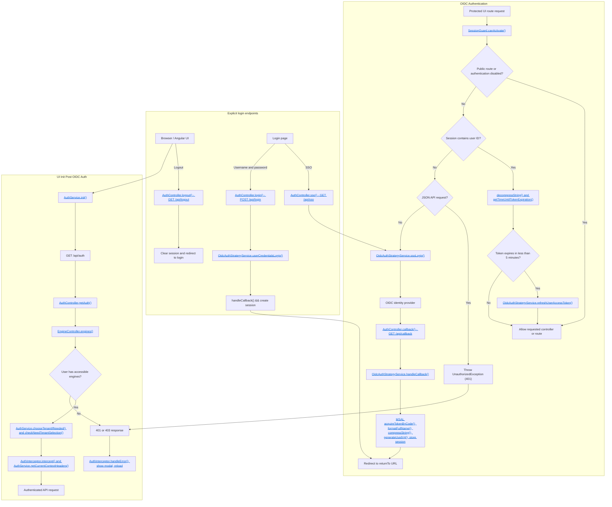

# Authentication

There are two contexts for authentication in the Fluxnova Control Center: authentication for accessing the UI itself, and
authentication for accessing the Fluxnova API. You can configure each of these independently, or you can choose to
disable authentication for either or both contexts. The following sections provide more details on the available options
for each context and how to configure them.

The following sections give a high-level overview of the environment variables are available to configure
Authentication. For full details, see [Configuration](./configuration.md#supported-configuration-variables)
documentation.

## UI Authentication

By default, to mirror the Fluxnova BPM Engine Rest API, the Fluxnova Control Center does not require
authentication. However unlike the REST API, you can configure the UI to use OpenID Connect (OIDC)
for authentication.

When authentication is disabled, the user will be redirected to the UI dashboard when attempting to
access the Login page.

When OIDC authentication is enabled, the user can access the Login page, and will have the ability
to login via SSO or by providing a username and password. The username and password will only work
if the OIDC provider has been configured to allow it. If it does not allow authentication via
username and password, the application will respond with a 401/403. To authenticate into the UI via
SSO, the user can access the Login page and click the "Login with SSO" button, or can navigate
directly to any page in the UI, and SSO login will happen automatically. If SSO fails, the user will
be returned to the Login page.

- `FXN_AUTH_STRATEGY`
  - Required
  - Available strategies: "oidc" or "none"
- `FXN_OIDC_AUTHORITY`
  - Required if `FXN_AUTH_STRATEGY` is set to "oidc"
  - The authority is the base URL of the OIDC provider
  - Example: https://login.microsoftonline.com/<REALM/TENANT>
- `FXN_OIDC_AUTH_URL`
  - Required if `FXN_AUTH_STRATEGY` is set to "oidc"
  - The URL to redirect to for authentication
  - Example: https://login.microsoftonline.com/<REALM/TENANT>/oauth2/v2.0/authorize
- `FXN_OIDC_CLIENT_ID`
  - Required if `FXN_AUTH_STRATEGY` is set to "oidc"
  - The client ID of the OIDC application.
- `FXN_OIDC_CLIENT_SECRET`
  - Required if `FXN_AUTH_STRATEGY` is set to "oidc"
  - The client secret of the OIDC application.
- `FXN_OIDC_KNOWN_AUTHORITIES`
  - Comma-separated list of known authorities for the OIDC provider
  - Default: value of `FXN_OIDC_AUTHORITY`
- `FXN_OIDC_SCOPE`
  - Comma-separated list of OIDC scopes
  - Default: `openid,profile,email,offline_access`
- `FXN_OIDC_ISSUER`
  - Required if `FXN_AUTH_STRATEGY` is set to "oidc"
  - The issuer URL of the OIDC provider
  - Example: https://login.microsoftonline.com/<REALM/TENANT>/v2.0
- `FXN_OIDC_TOKEN_URL`
  - Required if `FXN_AUTH_STRATEGY` is set to "oidc"
  - The URL to obtain the OIDC token
  - Example: https://login.microsoftonline.com/<REALM/TENANT>/oauth2/v2.0/token
- `FXN_OIDC_USERINFO_URL`
  - Required if `FXN_AUTH_STRATEGY` is set to "oidc"
  - The URL to obtain the OIDC user info from
  - Example: https://graph.microsoft.com/oidc/userinfo

### API Authentication

If the Fluxnova API is behind a security layer and the Fluxnova Control Center needs to authenticate with that
security system, you can configure that.

If API authentication is enabled, the UI will obtain an access token from the API auth configuration
and include it in requests to the Fluxnova API.

The following are the environment variables used to configure API authentication:

- `FXN_API_AUTH_ENABLED`
  - Whether to enable API authentication
  - Default: false
- `FXN_API_AUTH_TOKEN_URL`
  - Required if `FXN_API_AUTH_ENABLED` is `true`
  - URL of the API management platform's auth token endpoint
- `FXN_API_AUTH_CLIENT_ID`
  - Required if `FXN_API_AUTH_ENABLED` is `true`
  - Client ID for authenticating with the API auth config.
- `FXN_API_AUTH_CLIENT_SECRET`
  - Required if `FXN_API_AUTH_ENABLED` is `true`
  - Client secret for authenticating with the API auth config.
- `FXN_API_AUTH_REQUEST_HEADER_NAME`
  - The name of the header to set the API auth token.
  - Default: Authorization

## Authentication Flow Diagram

